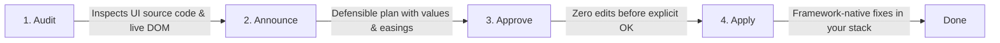

# UI Motion Principles

<p align="center">
  <a href="https://skills.sh/jigneshis/ui-motion-principles/ui-motion-principles">
    
  </a>
  <a href="https://www.npmjs.com/package/skills">
    
  </a>
  <a href="LICENSE">
    
  </a>
  <a href="https://github.com/jigneshis/ui-motion-principles/stargazers">
    
  </a>
</p>

<p align="center">
  <strong>An open-source AI agent skill that audits your web or mobile UI against 20 classic animation principles and UX laws, announces a defensible plan with concrete values, waits for your approval, and applies the code fixes.</strong>
</p>

<p align="center">
  Works with <strong>Claude Code</strong>, <strong>Gemini CLI</strong>, <strong>Cursor</strong>, <strong>Windsurf</strong>, <strong>Antigravity</strong>, and any assistant supporting the <a href="https://skills.sh">Agent Skills specification</a>.
</p>

---

## Why UI Motion Principles?

Most AI-generated animations look generic or sluggish—defaulting to `transition: all 0.3s ease`, scaling modals from screen center, or animating high-frequency interactions that should feel instantaneous.

**UI Motion Principles** brings intentionality back to modern frontend interfaces:
- **Defensible Decisions:** Every transition explains *what happened* and *where it came from*.
- **Grounded Physics:** Origin awareness, anticipatory nudges, non-linear easing curves, and natural spring dampening.
- **Cognitive Ergonomics:** Guided by classic UX laws (Doherty threshold, Fitts's law, Hick's law, Von Restorff effect, peak-end rule).
- **Zero Surprises:** Strict **Audit ➔ Announce ➔ Approve ➔ Apply** workflow. The agent will **never** edit your code without your approval.

---

## The 4-Stage Workflow



1. **Audit:** Reads your component code, Tailwind configuration, CSS, and animation definitions. If a live URL is provided and browser tools are active, inspects real runtime interactions.
2. **Announce:** Lists each proposed change as `I will apply [principle] to [place]: [change]` with exact values (durations in ms, cubic-bezier curves, target sizes in px).
3. **Approve:** Pauses and waits for your review. You decide whether to apply all changes, select a subset, or adjust the plan.
4. **Apply:** Implements only approved changes using your project's existing libraries (Tailwind, Framer Motion, Vanilla CSS, etc.) without introducing bloat.

---

## Quick Install

### 1. Via [skills.sh](https://skills.sh) / `skills` CLI (Universal)
Works across dozens of AI assistants:
```bash
npx skills add jigneshis/ui-motion-principles
```

### 2. Claude Code
Install directly or activate via slash command:
```bash
npx skills add jigneshis/ui-motion-principles -a claude-code
```
Inside Claude Code:
```text
/ui-motion-principles
```

### 3. Gemini CLI
```bash
gemini skills install https://github.com/jigneshis/ui-motion-principles --path skills/ui-motion-principles
```
Activate by asking:
> *"Use the ui-motion-principles skill to audit my site's UI."*

### 4. Cursor & Windsurf
Drop this repository into your workspace, or copy `.cursor/rules/ui-motion-principles.mdc` into your project's `.cursor/rules/` directory.

### 5. Manual Installation
Copy the `skills/ui-motion-principles/` directory into your agent's skills location:
- Claude Code: `~/.claude/skills/ui-motion-principles/`
- Gemini CLI: `~/.gemini/skills/ui-motion-principles/`
- Universal Agent Path: `.agents/skills/ui-motion-principles/`

---

## The 20 Principles at a Glance

### 13 Animation Principles
| Principle | Core Rule | Typical Recipe |
| :--- | :--- | :--- |
| **Origin Awareness** | Elements emerge from their trigger, not screen center | `transform-origin: top left;` or anchor position |
| **Anticipation** | Brief preparatory motion before the main action fires | Scale `0.97` on `:active` button click |
| **Squash & Stretch** | Compress along collision axis; expand perpendicular | 5–8% deformation scale; preserve volume |
| **Slow In, Slow Out** | Natural acceleration & deceleration; eliminate linear ease | `cubic-bezier(0.16, 1, 0.3, 1)` for entrances |
| **Arcs** | Multi-axis translations bow along curved trajectories | Split x/y durations or independent easings |
| **Timing** | Duration scales with distance travelled & perceived mass | Tokens: `120ms` (fast), `200ms` (base), `320ms` (slow) |
| **Exaggeration** | Push critical beats beyond realism for immediate legibility | Error shake (3–4 oscillations of 6–10px over 300ms) |
| **Follow Through** | Moving elements overshoot slightly and settle naturally | Spring physics: `stiffness: 400, damping: 28` |
| **Secondary Action** | Subtle accompanying motion that reinforces primary action | Checkmark path draw during button fill |
| **Staggering** | Sequential entrance cascade for lists and grids | 20–60ms delay per child; total cap < 400ms |
| **Rubber Banding** | Elastic boundary resistance at limits rather than hard stop | Overscroll / sheet drag resistance damping (0.3–0.5) |
| **Interruptible Motion** | Mid-flight animations retarget immediately on new input | CSS transitions over fixed keyframes; velocity springs |
| **Solid Drawing** | Physically consistent light source, elevation, and radii | Elevation-matched `box-shadow` + directional Y lift |

### 6 UX Laws & The Golden Frequency Rule
| UX Law | Impact on UI Design | Guideline |
| :--- | :--- | :--- |
| **Frequency of Use** | *The Master Override Rule.* Repetition breeds fatigue | High-frequency: ≤100ms or instant. Low-frequency: expressive |
| **Doherty Threshold** | Response budget < 400ms maintains conversational flow | Immediate feedback (<100ms); optimistic UI over spinners |
| **Fitts's Law** | Target acquisition speed = distance / target size | Touch targets ≥ 44×44px (iOS) / 48×48px (Material) |
| **Hick's Law** | Decision time increases with number of options | Group choices; progressive disclosure; recommend 1 default |
| **Von Restorff Effect** | Distinct items command attention and memory | Single primary CTA per view; preserve accent contrast |
| **Peak-End Rule** | Users judge experiences by peak intensity and conclusion | Invest delight budget in success states and flow completion |

---

## Conflict Resolution Hierarchy

When principles collide, resolve them using this strict priority order:

```text
Accessibility (prefers-reduced-motion, contrast, tap targets)
   └── Frequency of Use (high-frequency actions beat decorative flourish)
         └── Doherty Threshold (speed budget beats prolonged animation)
               └── Hick's & Fitts's Laws (reduce choices, then make key actions large)
                     └── Von Restorff Effect (baseline calm before emphasis)
                           └── Animation Aesthetics (timing, arcs, springs)
```

---

## Example Before & After

### Generic Unconsidered Button
```css
/* ❌ Sluggish, linear, ungrounded */
.button {
  transition: all 0.3s ease;
}
.button:hover {
  opacity: 0.8;
}
```

### Intentional UI Motion Principles
```css
/* ✅ Tactile, responsive, physically grounded */
.button {
  transform-origin: center;
  transition: transform 120ms cubic-bezier(0.2, 0.8, 0.2, 1),
              box-shadow 160ms cubic-bezier(0.16, 1, 0.3, 1),
              background-color 140ms ease;
}
.button:hover {
  transform: translateY(-1px);
  box-shadow: 0 4px 12px rgba(0, 0, 0, 0.08);
}
.button:active {
  /* Anticipation & Squash */
  transform: translateY(0px) scale(0.98);
  box-shadow: 0 2px 4px rgba(0, 0, 0, 0.04);
}
@media (prefers-reduced-motion: reduce) {
  .button { transition: none; transform: none; }
}
```

---

## Example Prompts

Copy-paste any of these prompts into your agent:

```text
Audit the checkout form in src/components/Checkout.tsx with ui-motion-principles. 
Focus on Fitts's law tap targets and the Doherty threshold.
```

```text
Use ui-motion-principles to review our mobile navigation drawer. 
Check origin awareness, rubber banding, and interruptibility.
```

```text
Review our pricing table using Hick's law and the Von Restorff effect. 
Propose concrete visual hierarchy adjustments before editing.
```

```text
Check the dropdown menus and modals in src/components/Nav.tsx. 
Ensure origin awareness and natural spring easing curves.
```

---

## Generative Engine Optimization (GEO) & Machine Access

This repository adheres to the `llms.txt` standard for automated indexing by AI agents and LLM search engines:
- [`/llms.txt`](llms.txt) — Concise overview and endpoint manifest for LLM crawlers.
- [`/llms-full.txt`](llms-full.txt) — Comprehensive consolidated documentation and reference recipes for direct agent context loading.

---

## Repository Structure

```
.
├── .cursor/rules/
│   └── ui-motion-principles.mdc     # Cursor IDE rule configuration
├── .github/workflows/
│   └── validate.yml                 # Automated skill structure validation
├── skills/
│   └── ui-motion-principles/
│       ├── SKILL.md                 # Core agent instructions & workflow
│       └── references/
│           ├── motion.md            # The 13 animation principles + CSS/Framer recipes
│           └── ux-laws.md           # The 6 UX laws & conflict resolution rules
├── CONTRIBUTING.md                  # Guidelines for contributing new recipes
├── LICENSE                          # MIT License
├── README.md                        # Project documentation
├── SECURITY.md                      # Security disclosures
├── llms.txt                         # AI context index
└── llms-full.txt                    # Full reference corpus for LLMs
```

---

## Contributing

We welcome community contributions! Please read our [Contributing Guide](CONTRIBUTING.md) to add framework recipes for Svelte, Vue, React Native, or SwiftUI.

---

## License

[MIT](LICENSE) © [jigneshis](https://github.com/jigneshis)
